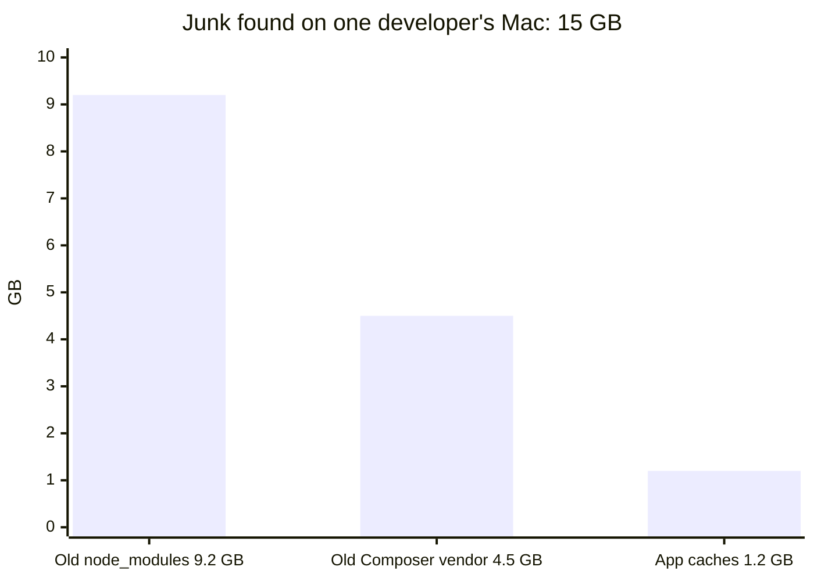

# JunkFinder

**Find the junk filling up your Mac. Clean it safely with one command.**



## What it cleans

| Junk | Example |
|---|---|
| App caches | Browser, Slack and Spotify caches |
| Old logs | Crash reports older than 7 days |
| Developer caches | Xcode build files, Homebrew, npm, pip downloads |
| Old `node_modules` | Projects you haven't installed in for 30+ days |
| Old Composer `vendor` | PHP projects you haven't installed in for 30+ days |
| Old installers | `.pkg` files sitting in Downloads |

All of it comes back on its own when you need it.

## Safe by default

- **Look first.** It shows everything and deletes nothing until you say yes.
- **Undo anytime.** Files go to the Trash, not straight to deletion.
- **Hands off your stuff.** Photos, documents, iCloud and mail are never touched.
- **Apps stay happy.** Caches of open apps are skipped.

## Try it

```sh
git clone https://github.com/digitaldreams/mac-junk-finder.git
cd mac-junk-finder
swift run -c release junk                               # see your junk
swift run -c release junk clean caches dev node_modules # clean it
```

Needs macOS 15 and Swift 6. A scan takes 2–3 minutes.

Pick what to clean: `caches`, `logs`, `dev`, `installers`, `node_modules`, `vendor`.

**Want the details?** See [how it works](docs/how-it-works.md).

## Bonus: a Claude Code skill

Using [Claude Code](https://claude.com/claude-code)? Open it in this folder and type `/mac-cleanup` (or just say "clean my mac"). Claude walks you through a full cleanup that goes beyond JunkFinder: it finds what is really eating your disk (Docker, old databases, WhatsApp media, app downloads), shows you a report, and removes only what you approve, one item at a time.
